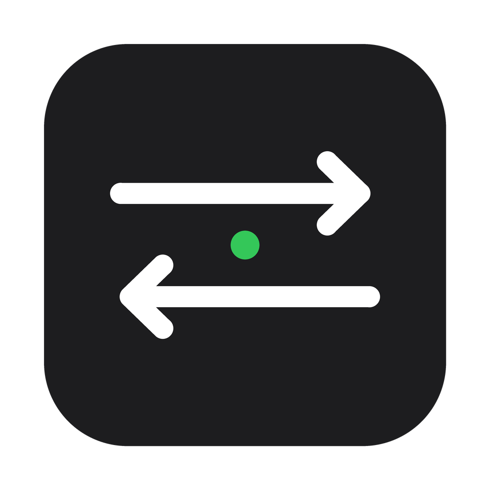

<p align="center">
  
</p>

<h1 align="center">NetSync · 内网同步</h1>

<p align="center">
  Mac ↔ Android 在同一个 Wi-Fi 下直接互传文件 —— 不经过云服务，不需要账号，不装服务器。
</p>

<p align="center">
  <a href="LICENSE"></a>
  
  
</p>

Local-first file sync between macOS and Android over your LAN. No cloud, no accounts, no relay.

---

## 为什么

手机和电脑明明在同一个 Wi-Fi 下，传文件却还要经过别人的服务器：网盘限速、微信压图、iCloud 只能同步它自己管的目录。

NetSync 只做一件事：**在你自己的局域网里，把两个文件夹同步成一样**。数据不离开你的网络。

## 特性

- **局域网直连**：Mac 端内嵌 HTTP 服务，手机直连电脑，不经过任何第三方
- **一个二维码**：同时承担「下载 Android App」和「配对」，扫码即用
- **自动同步**：手机 App 回到前台立即同步一次，之后每 60 秒一次；也可以手动点「立即同步」
- **双向同步**：新增 / 修改 / 删除都会同步；两边同时修改时保留较新的一份，另一份存为冲突副本
- **多文件夹**：Mac 端可添加任意多个目录，手机上为每个目录选择本地位置
- **设备管理**：同步拓扑图实时显示在线 / 离线，可单独暂停某台手机的同步
- **零外部依赖**：Mac 端是原生 App，不需要 Docker、数据库或常驻终端

## 工作方式

```text
┌──────────────┐        HTTP :8765         ┌──────────────────────────┐
│ Android App  │  ⇄  X-Sync-Token 鉴权  ⇄  │ macOS App（内嵌服务）     │
│ Java + ZXing │                            │ Swift / AppKit           │
└──────────────┘                            │  └─ 直接读写本地文件夹    │
                                            └──────────────────────────┘
```

- Mac 端启动后监听 `8765`，生成随机配对令牌；手机扫码拿到 `host + port + token`
- 之后的每个请求都带 `X-Sync-Token`，服务只接受已配对的设备
- 手机按「大小 + 修改时间」判断文件是否变化，只传有变化的文件
- 服务状态保存在 `~/Library/Application Support/NetSync/`

## 快速开始

### 1. 构建 Mac 端

需要 macOS 12+ 和 Xcode Command Line Tools（`xcode-select --install`）。

```bash
git clone https://github.com/lvhao/net-sync.git
cd net-sync
./build-mac.sh
open NetSync.app
```

首次打开会请求文件夹访问权限，选择要同步的目录并允许。

也可以双击 `启动同步.command`，直接用命令行版服务。

### 2. 构建 Android 端

需要 JDK 17、Android SDK 34 和 Gradle。

```bash
cd android
gradle assembleDebug
```

产物在 `android/app/build/outputs/apk/debug/app-debug.apk`。

如果想让 Mac 端的「下载 Android App」按钮可用，把 APK 放到 `out/netsync.apk`：

```bash
mkdir -p out
cp android/app/build/outputs/apk/debug/app-debug.apk out/netsync.apk
./build-mac.sh   # 重新构建，把 APK 打进 App
```

> `android/local.properties` 是本机 SDK 路径，已被 gitignore；Android Studio 会自动生成。

### 3. 配对

1. Mac 上打开 NetSync，窗口左侧出现二维码
2. 手机安装 APK（扫同一个二维码可直接下载，也可以手动安装）
3. 手机点「扫码添加电脑」，扫 Mac 窗口里的二维码
4. 给每个文件夹选择手机上的目标目录

完成。之后手机回到前台会自动同步。

## 使用

### Mac 端

- 双击 `NetSync.app` 即可，不需要开终端
- 左侧是使用说明：**一个二维码**同时承担安装与配对（已装 App 会直接打开配对，没装则先下载）
- 右侧是一张同步拓扑图，也是唯一的操作区：
  - 左卡片 = 这台电脑 + 文件夹清单（名称下显示完整路径）
  - 卡片底部「＋ 添加文件夹」是新增目录的唯一入口
  - 悬停文件夹行，右侧出现「×」可移除该目录（只解除同步，不删文件）
  - 连线：**实线 = 已连接，虚线 + 红色 × = 已断开 / 离线**
  - 90 秒收不到手机心跳即显示离线；离线超过 2.5 分钟自动从拓扑移除，
    同一台手机重新配对产生的新设备 ID 也会顶掉同名的旧节点
  - 点连线可暂停或恢复这台手机的同步
- 关掉窗口即停止服务（菜单栏图标可重新打开）

### 同步规则

- 只传有变化的文件（按大小 + 修改时间判断）
- 一侧新增 → 复制到另一侧
- 一侧修改 → 推到另一侧
- 一侧删除 → 另一侧同步删除
- 两边同时改 → 保留较新的一侧，另一份存为 `*.conflict-时间戳`

### 不同步的内容

| 排除项 | 原因 |
|---|---|
| `.git` `.smart-env` `.obsidian` | 体积大、各设备各建各的 |
| `copilot` `videos` | 缓存与大素材，手机不需要 |
| `*.db` `*.sqlite` 等数据库文件 | 运行中的数据库不适合边改边传 |
| `*.conflict-*` `*.part` | 冲突副本与临时文件 |

命令行版还支持在目录里放 `.netsyncignore`，一行一条规则。

## 命令行版（开发调试）

`mac_server.py` 是同一套协议的命令行实现，方便在终端里调试：

```bash
python3 -m pip install -r requirements.txt    # 生成配对二维码需要 qrcode
NETSYNC_FOLDER=~/notes ./run-server.sh        # 指定同步目录（默认当前目录）
./run-server.sh --port 8765                   # 换端口
./run-server.sh --print-pairing               # 打印配对地址和二维码
./start-bg.sh                                 # 后台启动
```

- 解释器可用 `NETSYNC_PYTHON` 指定（项目内的 `.env.local` 会被自动读取）
- 日志：`~/Library/Application Support/NetSync/server.log`

## 安全

- 只监听局域网，不经过任何第三方服务器
- 所有文件请求都要带配对令牌（`X-Sync-Token`）
- 令牌首次启动随机生成，只保存在本机
- **注意**：传输是明文 HTTP，安全性依赖你对局域网环境的信任，不要暴露到公网

## 项目结构

```text
net-sync/
├── macapp/                 # macOS App（Swift / AppKit）
│   ├── main.swift
│   ├── app.swift           # 窗口、二维码、同步拓扑图
│   ├── server.swift        # 内嵌 HTTP 同步服务
│   ├── Info.plist
│   └── icon/               # App 图标源文件
├── android/                # Android 客户端（Java + ZXing 扫码）
│   └── app/src/main/java/com/lvhao/netsync/
├── mac_server.py           # 命令行版服务
├── mac_gui.py              # 旧版 Python GUI（保留参考）
├── build-mac.sh            # 构建 NetSync.app
├── run-server.sh           # 前台运行命令行版
├── start-bg.sh             # 后台运行命令行版
├── requirements.txt
└── out/                    # Android 产物（gitignore）
```

## 已知限制

- 仅在同一个局域网内可用，不做 NAT 穿透 / 中继
- 手机端是轮询同步（前台每 60 秒），不是实时监听
- 按整文件传输，没有块级增量
- 数据库文件（`*.db` / `*.sqlite`）默认跳过，避免同步到写入中的状态
- 只有 macOS + Android，没有 iOS / Windows 客户端
- 个人项目，接口和界面都可能变

## License

[MIT](LICENSE) © 2026 lvhao

## 致谢

- [ZXing](https://github.com/zxing/zxing)（Apache-2.0）—— Android 端扫码
- [AndroidX CameraX](https://developer.android.com/jetpack/androidx/releases/camera) —— 相机预览
- [qrcode](https://github.com/lincolnloop/python-qrcode) —— 命令行版配对二维码
